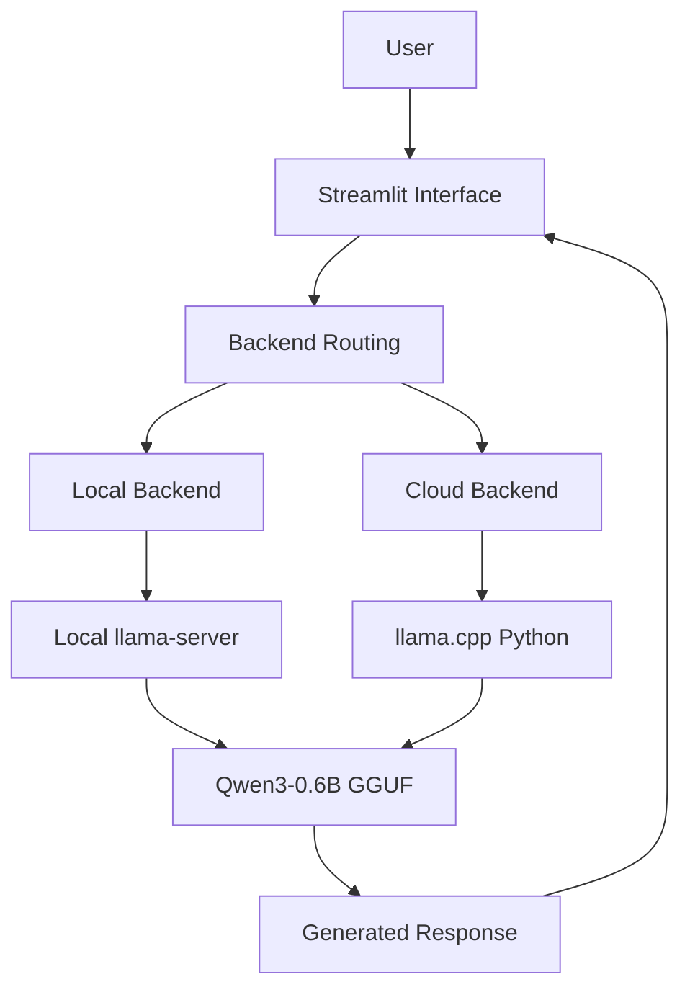
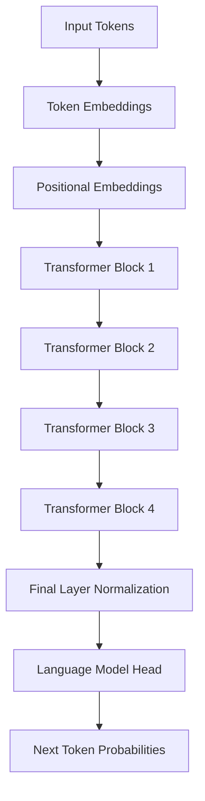

# Chatty — Mini-GPT Research & Conversational AI

<p align="center">
  <strong>A lightweight conversational AI application built alongside a Transformer language model trained from scratch.</strong>
</p>

<p align="center">
  <a href="https://chatty-mtdbujzxmu8omjbcmsautt.streamlit.app/">Live Demo</a>
</p>

## Overview

Chatty is a Streamlit-based conversational application developed alongside a small GPT-style language model implemented and trained from scratch using PyTorch.

The project combines two independent components:

- **Mini-GPT:** A decoder-only Transformer trained on WikiText-103 for language modeling and inference experiments.
- **Chatty Assistant:** A conversational interface powered by Qwen3-0.6B, using llama.cpp for local and cloud inference.

The two models serve different purposes. Qwen3 handles conversations, while Mini-GPT is retained as a research model for studying Transformer architecture and optimization.

## System Architecture

### Chatty — Conversational Application

The application supports both local development and cloud deployment.



### Mini-GPT — Transformer Architecture

The research model is a four-layer decoder-only Transformer.



Each Transformer block contains causal self-attention, feed-forward layers, residual connections, and layer normalization.

## Mini-GPT Configuration

| Parameter | Value |
|---|---:|
| Architecture | Decoder-only Transformer |
| Parameters | 1,833,728 |
| Vocabulary size | 8,000 |
| Context length | 128 |
| Embedding dimension | 128 |
| Transformer layers | 4 |
| Attention heads | 4 |
| Feed-forward dimension | 512 |
| Dropout | 0.1 |

**Dataset:** WikiText-103 (raw)

**Tokenizer:** Custom Byte Pair Encoding (BPE), vocabulary of 8,000 tokens.

## Research Experiments

The project investigates model performance, inference optimization, numerical precision, and architecture depth.

### 1. Language Modeling

Initial comparison against a bigram baseline:

| Model | Test Perplexity | Accuracy |
|---|---:|---:|
| Mini-GPT | 165.22 | 18.90% |
| Bigram | 288.56 | 14.78% |

### 2. KV-Cache

Implemented a KV-cache for autoregressive generation.

- Cached and uncached logits matched exactly.
- Maximum absolute difference: `0.0`.
- The tested benchmark did not demonstrate a speed improvement.

### 3. Quantization

Experiments included FP16, dynamic INT8, and INT4 feasibility.

| Precision | Perplexity | Storage |
|---|---:|---:|
| FP32 | 145.6932 | 6.995 MB |
| FP16 | 145.6903 | 3.498 MB |
| INT8 | 145.8682 | 5.752 MB |

FP16 reduced model tensor storage by approximately 50% while maintaining similar evaluation quality.

INT4 quantization was attempted but could not be completed successfully in the tested environment.

### 4. Architecture Ablation

Compared two Transformer depths using three matched random seeds and the same training protocol.

| Metric | 4 Layers | 2 Layers |
|---|---:|---:|
| Parameters | 1,833,728 | 1,437,184 |
| Test Cross-Entropy | **5.10479** | 5.13428 |
| Perplexity | **164.811** | 169.741 |
| Accuracy | **18.778%** | 18.419% |

The four-layer model achieved better language-modeling results, while the two-layer model used approximately 21.6% fewer parameters.

## Chatty Features

- Conversational interface with Qwen3-0.6B.
- Local and cloud inference backends.
- English, French, and Arabic response preferences.
- Multiple response styles and customizable instructions.
- Temperature, top-p, and maximum-token controls.
- Light and dark themes.
- Conversation creation, switching, and deletion.
- Import and export of conversations in JSON and Markdown.
- Basic Arabic right-to-left rendering.

## Technology Stack

| Area | Technologies |
|---|---|
| Language | Python |
| Deep Learning | PyTorch |
| Transformer | Custom GPT implementation |
| Tokenization | Hugging Face Tokenizers |
| Conversational Model | Qwen3-0.6B |
| Inference | llama.cpp, GGUF |
| Interface | Streamlit |
| Data Processing | NumPy |
| Deployment | Streamlit Community Cloud |
| Version Control | Git, GitHub |

## Run Locally

Clone the repository:

```bash
git clone https://github.com/Nouha-Kambouz/Chatty.git
cd Chatty
```

Create a virtual environment:

```bash
python -m venv .venv
```

Activate it on Windows:

```cmd
.venv\Scripts\activate
```

Install dependencies:

```bash
pip install -r requirements.txt
```

Install llama.cpp and start the Qwen3 server:

```bash
llama-server -hf QuantFactory/Qwen3-0.6B-GGUF:Q4_K_M --host 127.0.0.1 --port 8080 --ctx-size 1024 --threads 2 --n-gpu-layers 0 --jinja
```

In another terminal, launch Chatty:

```bash
streamlit run app.py
```

## Limitations & Future Work

- Mini-GPT is an educational language model, not an instruction-tuned conversational assistant.
- KV-cache correctness was verified, but speed improvements were not observed in the tested configuration.
- INT4 quantization requires further investigation.
- Conversation history is currently session-based rather than stored in a persistent database.
- Broader multilingual evaluation and grammar correction remain future improvements.

## Author

**Nouha Kambouz**

Computer Science Engineering Student — AI & Data Science

- GitHub: [Nouha-Kambouz](https://github.com/Nouha-Kambouz)
- Live Application: [Chatty](https://chatty-mtdbujzxmu8omjbcmsautt.streamlit.app/)

---

*Chatty — Exploring language models from architecture to application.*
